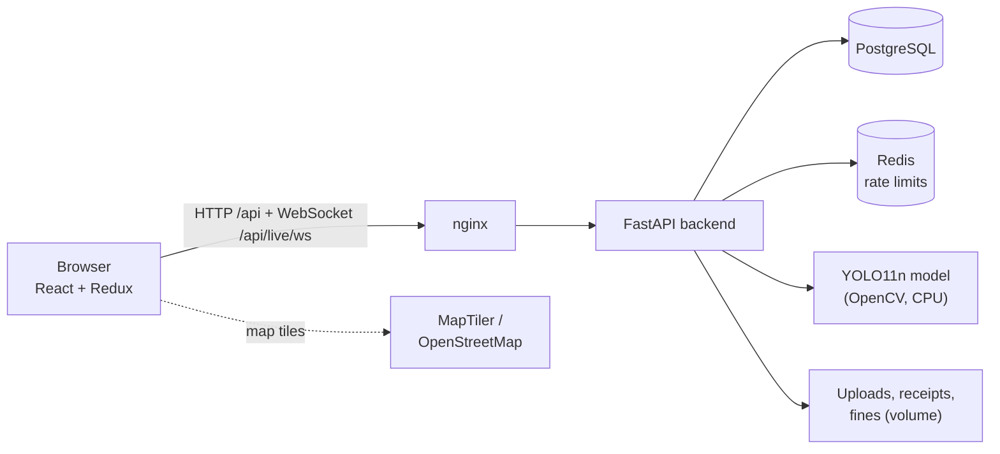
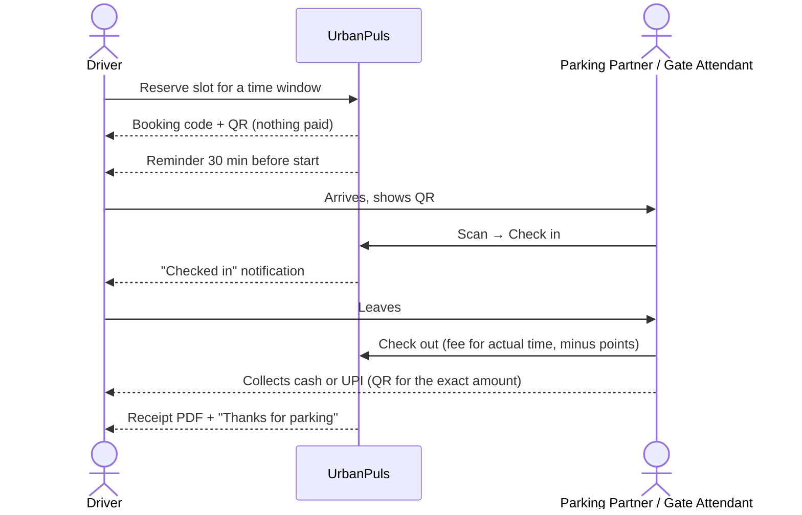

# 🅿 UrbanPuls : Traffic & Parking Management System

A full-stack web app for city parking, built for Mumbai. Drivers reserve car or two-wheeler parking and **pay at the gate** only for the time they actually park. Parking lot owners run their gates from a phone or tablet. Citizens report illegal parking, and a YOLO model finds vehicles standing in no-parking areas.

Available in **English, हिंदी and मराठी**.


---

## Features

**Parking for drivers**
- Live map of parking lots with free car and two-wheeler slots, prices, ratings and reviews
- "Near me" sorting and one-tap directions (opens Google Maps)
- Reserve a slot for a time window and get a QR code. Nothing is paid online
- Pay at the gate in cash or UPI for the time actually parked; reward points give a discount
- Extend or cancel bookings, download PDF receipts, rate visits
- Reminders 30 minutes before a booking, and live notifications in the app and by email

**Running a parking lot (Parking Partners)**
- **Gate screen**: scan the booking QR (or type the code / vehicle number), check cars in and out, handle walk-ins
- Checkout works out the fee and shows a **UPI QR for the exact amount**, paid straight to the partner
- Manage lots on a map: car and two-wheeler slots, separate rates, UPI details, switch slots off for repairs
- **Gate staff accounts**: attendants who can only use the Gate screen
- Home page with today's takings (cash / UPI), cars parked, arrivals due and occupancy per lot
- Revenue reports by day, week or month, exported as CSV or PDF

**Complaints and enforcement**
- Citizens report illegal parking, road blockages, accidents and more, with GPS location and a photo
- Admins verify or reject reports; verified reporters earn reward points and a fine PDF is generated
- **Field Officers** get a map of verified complaints and mark them resolved; reporters see a status timeline
- **Violation detection**: a YOLO11 model finds vehicles in a camera photo and flags those whose wheels are inside no-parking areas drawn on that camera's view

**Platform**
- Five roles, each with its own menu and home page (see below)
- Live updates over a WebSocket: availability, notifications, violation alerts
- Admin tools: user search, roles, partner approvals, staff accounts
- Account security: email verification, password reset, rate limiting, "sign out everywhere" on password change
- Privacy: download all your data, delete your account, consent recorded at sign-up
- Traffic density charts and busiest / quietest hours per lot
- Emergency page with one-tap calls to police (100), ambulance (108) and fire (101)

## Who uses it

| Role | Who they are | What they do | Their main screens |
|------|--------------|--------------|--------------------|
| 🚗 **Driver** | Any member of the public | Reserve parking, pay at the gate, report problems, earn points | Map, Bookings, Complaints |
| 🏢 **Parking Partner** | Owner or operator of a parking lot (needs admin approval) | Run the gate, manage lots and prices, add gate staff, see revenue | Gate, Zones, Reports, Staff |
| 🚧 **Gate Attendant** | Staff added by a Parking Partner | Check cars in and out and record payments for their employer's lots only | Gate |
| 🦺 **Field Officer** | Staff who act on the ground (your team, lot security, or traffic police) | Resolve verified complaints, run violation detection | Enforcement, Detection, Cameras |
| 🛡 **Admin** | The operator of UrbanPuls | Verify complaints, approve partners, manage users and staff accounts | Dashboard, Admin |

Staff roles can still park like drivers from the **"Park a car"** menu. Nobody can make themselves an admin or partner at sign-up.

> In the code and database, Parking Partners are the `vendor` role and Field Officers the `police` role.

## Quick start (Docker)

Needs [Docker Desktop](https://www.docker.com/products/docker-desktop/).

```bash
git clone https://github.com/SamruddhiKadam2023in/traffic-parking-ps.git
cd traffic-parking-ps
cp backend/.env.example backend/.env        # Windows: copy backend\.env.example backend\.env
docker compose up --build -d
docker compose exec backend python seed.py  # demo accounts, 5 Mumbai lots, traffic data
```

Open **http://localhost:5173** and use the "Sign in as…" buttons on the sign-in page.

This starts PostgreSQL, Redis, the FastAPI backend (migrations run automatically) and the React app behind nginx. Only port **5173** is published.

```bash
docker compose logs -f backend   # backend logs; emails are printed here until SMTP is configured
docker compose down              # stop (data is kept in Docker volumes)
```

**Optional:** for a dark street map, get a free key from [MapTiler](https://cloud.maptiler.com) (allowed origin: `localhost`), put `VITE_MAPTILER_KEY=...` in a `.env` file next to `docker-compose.yml`, and run `docker compose up --build -d` again. Without a key the map uses OpenStreetMap tiles.

## Running without Docker

Needs Python 3.11+ and Node.js 20+. Uses SQLite, so no database server is needed.

**Windows shortcut:** run `setup_windows.bat` once, then `start.bat`.

**Manually:**

```bash
# Terminal 1: backend
cd backend
python -m venv venv
venv\Scripts\activate                        # macOS/Linux: source venv/bin/activate
pip install -r requirements-dev.txt
copy .env.example .env                       # macOS/Linux: cp .env.example .env
alembic upgrade head
python seed.py
uvicorn main:app --reload --port 8000

# Terminal 2: frontend
cd frontend
npm install
npm run dev
```

Open **http://localhost:5173**. API docs: **http://localhost:8000/docs**.

If port 8000 is already taken, start the backend with `--port 8001` and the frontend with `VITE_API_TARGET=http://localhost:8001 npm run dev` (PowerShell: `$env:VITE_API_TARGET="http://localhost:8001"; npm run dev`).

## Demo accounts

Created by `seed.py` (never in production). The sign-in page has one-click buttons for them.

| Role | Email | Password |
|------|-------|----------|
| Driver | user@urbanpuls.com | user123 |
| Parking Partner | vendor@urbanpuls.com | vendor123 |
| Gate Attendant (works for the demo partner) | gate@urbanpuls.com | gate12345 |
| Field Officer | police@urbanpuls.com | police123 |
| Admin | admin@urbanpuls.com | admin123 |

A good first test: sign in as the driver in one window and the Parking Partner in a private window. Reserve a slot as the driver, then check it in on the partner's Gate screen; the driver's page updates live.

## How it works

### Architecture



### A booking from start to finish



### Booking rules

| Rule | Value |
|------|-------|
| Billing | Actual time parked, minimum 1 hour, then 30-minute steps, at the rate locked in when booking |
| Check-in window | Opens 30 minutes before the start time |
| No-show | Not checked in 15 minutes after the start time → slot released |
| Active bookings | At most 2 per driver |
| Repeated no-shows | 3 in 30 days pauses online booking (walk-ins still work) |
| Reward points | 10 per verified complaint; 1 point = ₹0.50 off parking |

If the booked slot is still occupied when a driver arrives (the previous car overstayed), check-in moves them to another free slot of the same vehicle type.

### Violation detection

`backend/yolo/model.onnx` is the pre-trained **YOLO11n** model, run on the CPU through OpenCV, so no GPU or PyTorch is needed at runtime. It finds cars, two-wheelers, buses, trucks and bicycles.

A vehicle in a photo is not illegal by itself; it depends on *where* it stands. So staff add a **camera** (a reference photo of one view) and draw its **no-parking areas** on it. When a photo from that camera is checked, a vehicle whose ground point (the bottom-centre of its box) falls inside an area is a violation, and a live alert goes to staff.

To re-create the model or train your own on labelled photos, see `backend/yolo/train_yolo.py`.

## Tech stack

| Layer | Technology |
|-------|------------|
| Frontend | React 18, Vite, Redux Toolkit, React Router, Leaflet, Recharts, i18next, react-hot-toast, qrcode.react, html5-qrcode |
| Backend | FastAPI, SQLAlchemy 2, Alembic, Pydantic 2, PyJWT, bcrypt, slowapi, ReportLab (PDFs) |
| Database | PostgreSQL 16 (Docker) or SQLite (local development) |
| Cache | Redis 7 (rate-limit counters) |
| Detection | YOLO11n (Ultralytics) exported to ONNX, OpenCV DNN |
| Serving | nginx (static app + reverse proxy for the API and WebSocket), Docker Compose |
| Testing | pytest (85 tests, run on SQLite and PostgreSQL) |

## Project structure

```
traffic-parking-ps/
├── backend/
│   ├── core/            settings, database, security (JWT, roles), rate limiting, time helpers
│   ├── models/          users, lots and slots, bookings, complaints, notifications, ratings, cameras
│   ├── routes/          auth, admin, zones, bookings, gate, vendors (partner tools),
│   │                    complaints, detection, traffic, notifications, live (WebSocket), alerts
│   ├── services/        booking rules, live events, notifications + translated messages,
│   │                    email, file storage, PDFs, violation geometry, SMS
│   ├── migrations/      Alembic database migrations
│   ├── yolo/            detector, model.onnx, labels, training/export script
│   ├── tests/           pytest suite
│   ├── seed.py          demo data (refuses to run in production)
│   └── create_admin.py  create the first real administrator
├── frontend/
│   ├── src/pages/       one file per screen
│   ├── src/components/  booking, gate, home pages per role, detection overlay, shared UI
│   ├── src/store/       Redux slices
│   ├── src/locales/     en.json, hi.json, mr.json
│   ├── scripts/         translation checker
│   └── nginx.conf       serving + API/WebSocket proxy
├── docker-compose.yml
├── setup_windows.bat    one-time local setup (Windows)
└── start.bat            start backend + frontend locally (Windows)
```

## Configuration

Backend settings are environment variables in `backend/.env`; see `backend/.env.example` for all of them. The defaults work for local use. Useful ones:

| Variable | Default | Purpose |
|----------|---------|---------|
| `DATABASE_URL` | `sqlite:///./tpms.db` | Database (Docker sets PostgreSQL automatically) |
| `SECRET_KEY` | placeholder | Signs login tokens; use a long random value outside development |
| `SMTP_HOST`, `SMTP_*` | empty | Send real emails; when empty, emails are printed in the backend log |
| `BOOKING_GRACE_MINUTES` | 15 | Minutes after the start time before a no-show |
| `MAX_ACTIVE_RESERVATIONS` | 2 | Active bookings per driver |
| `NO_SHOW_LIMIT` | 3 | No-shows in 30 days before booking is paused |
| `CLOUDINARY_*` | empty | Store photos in Cloudinary instead of local disk |

Frontend build settings (in `frontend/.env.local` for `npm run dev`, or a `.env` next to `docker-compose.yml` for Docker; see the `.env.example` files):

| Variable | Purpose |
|----------|---------|
| `VITE_MAPTILER_KEY` | Dark MapTiler map; OpenStreetMap is used without it |
| `VITE_OPERATOR_NAME`, `VITE_CONTACT_EMAIL`, `VITE_CITY` | Shown on the landing, privacy and terms pages |
| `VITE_API_TARGET` | Backend address for `npm run dev` (default `http://localhost:8000`) |

## Development

**Tests**

```bash
cd backend
pytest                                   # SQLite
TEST_DATABASE_URL=postgresql://... pytest   # PostgreSQL
```

**Database changes** are managed with Alembic. After changing a model:

```bash
alembic revision --autogenerate -m "describe the change"
alembic upgrade head
```

`tests/test_migrations.py` fails if a model changes without a migration.

**Translations.** English text is written in the code as `t('key', 'English text')`; Hindi and Marathi live in `frontend/src/locales/`.

```bash
cd frontend
npm run i18n:sync    # update en.json from the code
npm run i18n:check   # fails if Hindi or Marathi misses a key or a {{placeholder}}
```

Server notifications and emails are translated in `backend/services/messages.py`.

**Creating a real admin** (instead of the demo one):

```bash
python create_admin.py --email you@example.com --name "Your Name"
# Docker: docker compose exec backend python create_admin.py --email ... --name "..."
```

## License

Copyright © 2026 Samruddhi Sanjay Kadam

UrbanPuls is free software: you can redistribute it and/or modify it under the terms of the **GNU Affero General Public License, version 3** (AGPL-3.0), as published by the Free Software Foundation. See [LICENSE](LICENSE) for the full text.

In short: you may use, change and share this project, including commercially. If you distribute a modified version, or run one as a service that other people use over a network, you must make your complete source code available to them under the same licence.

The bundled detection model (`backend/yolo/model.onnx`, YOLO11n) is © Ultralytics and is itself released under [AGPL-3.0](https://github.com/ultralytics/ultralytics/blob/main/LICENSE).
